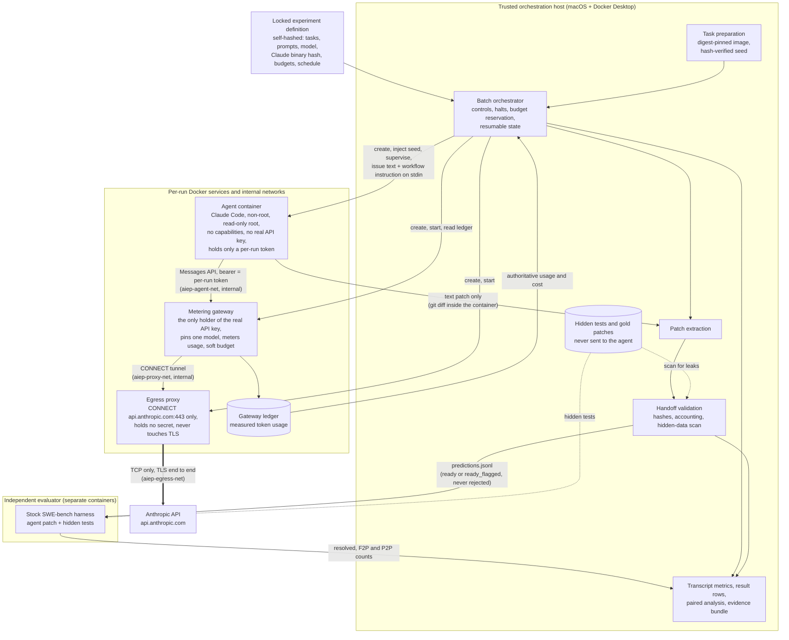

# AIEP

### Agentic Intelligence & Evaluation Platform

AIEP is a local-first research harness for the controlled evaluation of AI coding agents. It runs Claude Code on SWE-bench Lite issues inside an isolated container, meters every API request outside the agent, and grades the resulting patch in a separate environment.

Python · Docker · Claude Code · SWE-bench Lite · agent evaluation

> **Research question.** Does prescribing an iterative test-and-fix workflow change how an AI coding agent resolves software engineering issues, and at what additional cost?

Two configurations answer it. They share one prompt template, model, task, image, limits and evaluator, and differ only in the workflow instruction:

| | Workflow instruction |
|---|---|
| **Config A** | Investigate the code, implement a fix, then stop. |
| **Config B** | Investigate and implement a fix, then run the relevant existing tests, analyse failures, revise and repeat, for at most 5 test-fix cycles. |

This is an exploratory research platform, **not** a benchmark and not a statistically powered study.

## E1 Stage 1 at a glance

The first (and only) scored batch ran 4 SWE-bench Lite tasks, once per configuration: 8 scored runs. Details are in the [frozen research report](docs/research/E1_STAGE1_REPORT.md); the data is in the committed [evidence bundle](evidence/e1-stage1/README.md).

| Measure | Result |
|---|---|
| Scored runs completed and valid | 8 of 8 |
| Passed handoff validation and graded | 8 of 8 |
| Gold and no-op evaluator controls passed | 8 of 8 |
| Tasks resolved | all four, in both configurations (8 of 8 runs) |
| Runs that started a test runner | **Config B: 4 of 4. Config A: 0 of 4.** |
| Confirmed fix-revision cycle after a failing test (manual transcript audit) | none |
| API requests | 34 (Config A 14, Config B 20) |
| Gateway-measured spend | $0.2337872 (A $0.1118429, B $0.1219443), computed from measured tokens, not provider billing |

> **What this does and does not show.** Stage 1 shows that the harness works end to end and that the prompt changes test-running behaviour. It does **not** show that iteration improves issue resolution: every task resolved in both arms (a ceiling effect), there is one repetition per task, and the cost figures are descriptive and confounded by prompt-cache warmth and run order. No statistical significance is claimed.

## Why AIEP exists

Comparing agent workflows is easy to get wrong. A fair comparison needs the pieces below to hold together, and AIEP is built around that requirement.

| Requirement | How AIEP addresses it |
|---|---|
| **Only the workflow differs** | A self-hashed, locked experiment definition fixes tasks, prompts, model, Claude binary hash, budgets and schedule. Handoff validation re-checks the recorded prompt, template and workflow hashes. |
| **The agent cannot see the answers** | The agent receives only the issue text. Hidden tests and gold patches stay on the host; only a text patch leaves the agent container. |
| **The agent never receives the real API key** | The agent receives only a per-run token and never the real upstream API key. The gateway holds the real key, and the egress proxy holds no secret. |
| **Usage is measured, not self-reported** | Cost is computed from tokens measured at the gateway. Claude Code's own cost estimate is stored separately and never used for accounting. |
| **Grading is independent** | The stock SWE-bench harness evaluates the patch in separate containers; gold and no-op controls must behave correctly first. |
| **Results are checkable** | Every run is a directory of hashed artifacts; a sanitized, committed evidence bundle can be re-verified offline. |

## Core capabilities

| Capability | What it does | Where |
|---|---|---|
| Locked experiment definitions | Self-hashed JSON; schedule re-derived from a seed and checked before and during a batch | `config/experiments/`, `scripts/m3_experiment.py` |
| SWE-bench task preparation | Images pulled and pinned by digest, `/testbed` extracted into a hash-verified seed, agent identity verified | `src/aiep/task_setup.py`, `scripts/pin_task_image.py` |
| Batch orchestration | Registered task order, gold/no-op controls, 600 s gap between arms, disk gates, pair-atomic budget reservation, explicit halts, resumable state; plan-only by default | `src/aiep/m3_batch.py`, `scripts/run_m3_pilot.py` |
| Isolated Claude Code execution | Non-root container on an internal network, read-only root, all capabilities dropped, no volumes or Docker socket | `src/aiep/agent_runner.py`, `container_policy.py` |
| Restricted egress proxy | CONNECT to one host and port only, validates every resolved address, never terminates TLS, holds no secret | `src/aiep/egress_proxy.py` |
| API gateway and token metering | Sole holder of the key; pins one model, forwards two endpoints, writes a ledger of measured usage, enforces a soft budget | `src/aiep/gateway.py`, `ledger.py`, `pricing.py` |
| Patch extraction and handoff validation | Text patch only; artifact hashes, identity, accounting exactness and a hidden-data scan before anything is graded | `src/aiep/patch.py`, `handoff.py` |
| Stock SWE-bench evaluation | `swebench==5.0.2` in a fresh container, wrapped to drop capabilities and block image acquisition | `src/aiep/stock_eval.py`, `grading.py` |
| Transcript analysis and results | Test-run and edit classification (parser v2), one result row per run, paired descriptive analysis | `src/aiep/transcript.py`, `results.py`, `analysis.py` |
| Evidence tooling | Sanitized bundle builder and offline verifier with schema-3 provenance | `scripts/build_e1_stage1_evidence.py`, `scripts/verify_e1_stage1_evidence.py` |

## Architecture



**How to read it.**

- **Request path.** The agent reaches the Anthropic API only through the gateway, and the gateway only through the proxy: agent, then gateway, then proxy, then API. The gateway terminates TLS itself through the proxy's CONNECT tunnel; the proxy copies bytes and never sees plaintext. This is the only route from the agent to the external API: the agent has no other network, and the thick arrow is the final hop out of the per-run Docker services.
- **Secrets.** The real API key exists on the host (in an environment variable) and in the gateway container. The agent has only a per-run token; the proxy has nothing.
- **Hidden data.** Hidden tests and gold patches live on the host. They reach the evaluator and the hidden-data scan, never the agent.
- **Separation.** The evaluator runs in separate containers after the agent run is finished and its patch has passed handoff validation.
- **Not drawn.** The evaluator's containers have general internet access (its build step fetches PyPI dependencies), the host itself is not network-restricted, and the proxy container can reach Docker Desktop host services. See [Known limitations](#known-limitations) and [`docs/ARCHITECTURE.md`](docs/ARCHITECTURE.md) section 4.

Full design: [`docs/ARCHITECTURE.md`](docs/ARCHITECTURE.md) (components, trust boundaries, lifecycle) and [`docs/M2_EGRESS_ARCHITECTURE.md`](docs/M2_EGRESS_ARCHITECTURE.md) (network topology, proxy rules, residual risks).

## How an experiment works

1. **Lock an experiment definition.** The definition is hashed and validated against the tracked configuration; locking, budgets and every execution approval are separate human decisions.
2. **Prepare pinned task environments.** Each task's image is pulled by digest and pinned, `/testbed` is read once from a never-started container into a hash-verified seed, and the container identity is checked. Gold and no-op controls must pass through the stock evaluator before the task's agent runs.
3. **Execute the configured agent workflows.** For each task both arms run back to back (with a 600 s gap) in a fresh isolated container, started in the order proxy, gateway, agent and torn down in reverse, with the live network attachments verified.
4. **Meter API usage.** Every forwarded request is written to the gateway ledger; the batch halts if accounting is incomplete or the cost cap is reached.
5. **Extract and validate patches.** Only a text diff leaves the container. Handoff validation checks artifact hashes, identity, accounting exactness and a hidden-data scan, and returns `ready`, `ready_flagged` or `rejected`.
6. **Grade independently.** Accepted patches go to the stock SWE-bench evaluator in separate containers.
7. **Parse transcripts and produce results.** The transcript parser classifies test runs and edits, and one result row per run is written.
8. **Analyze paired outcomes.** A descriptive paired analysis compares the two arms per task.

Failed and invalid runs are kept, not discarded.

## Research results and interpretation

E1 Stage 1 (`config/experiments/e1-exploratory-1.json`, locked; definition sha256 `9601b345da705b7e8bbdba251b902f4c7637482fd2e87e732dcba0dc36875eff`) used sympy-18621, django-13933, django-15851 and sympy-22714. Stage 2 (sphinx-10325, requests-863) is conditional, unprepared and was not run. Two earlier calibration runs (12 requests, about $0.09 gateway-computed) measured cost and behaviour; they are never scored.

**Established:** the harness runs end to end with exact accounting and recorded isolation checks, and, as an observation from one repetition per task, Config B started a test runner in 4 of 4 runs against 0 of 4 for Config A. The manual transcript audit found the parser's one test-fix cycle (django-15851, B) changed a test expectation, not the fix.

**Not established:** whether iteration improves resolution; any statistical or causal claim; any statement about other models, agents or tasks.

Read the full account in the [research report](docs/research/E1_STAGE1_REPORT.md). It is frozen: it is never edited, a test pins its SHA-256, and it cites the original execution commit, which [`docs/HISTORY_REWRITE.md`](docs/HISTORY_REWRITE.md) maps to this repository's history. Check its figures yourself with `python3 scripts/verify_e1_stage1_evidence.py` against the [evidence bundle](evidence/e1-stage1/).

## Quickstart

Everything here is read-only or runs against fakes: no credentials, Docker or API access, and no spending.

**Prerequisites.**
- **Python 3.12.** `pyproject.toml` allows 3.10 or newer, but only 3.12 has been tested, on macOS (Apple Silicon). Linux and Windows have not been tried.
- **A full `git clone`, not a shallow one.** Two tests compare files with commit `5bae33a` in the history, so a `--depth 1` clone is expected to fail them (inferred from the test code, not tested), and the evidence verifier's history checks need full history.
- **`uv`** for the install commands (any virtualenv plus `pip` works too).
- **Network access only for the install step** (PyPI). Nothing after it needs a network, Docker, an API key or any file outside the repository.
- Steps 3 to 5 use only the Python standard library and this repository's `src/`, so they also run on a plain `python3` with nothing installed. Only the test suite (step 2) needs the installed packages.

**1. Install** (requires PyPI; needed for the test suite only).

```bash
uv venv --python 3.12 .venv
uv pip install --python .venv/bin/python -e . pytest                 # latest compatible versions
# or, to reproduce the tested closure exactly (generated on CPython 3.12.2, macOS arm64):
uv pip install --python .venv/bin/python -r requirements/host.lock -e .
```

These two commands were **not** run for this README (the offline test environment could not download packages). What was checked is that `requirements/host.lock` matches the packages installed in the environment the tests ran in (`.venv/bin/python scripts/lock_host_deps.py --check` exits 0).

**2. Offline test suite.**

```bash
.venv/bin/python -m pytest
```

In one observed fresh-clone run the result was `3441 passed, 7 skipped` in about 3 minutes 15 seconds, with no failures. This is an observation from one environment, not a guaranteed result: the counts change whenever tests are added, and the skips depend on which private or optional data is present. The run used a copy of the repository without `runs/`, `.cache/` or `.venv/`, with real git history, using an existing virtual environment with the same packages. The 7 skips are expected on a clone: 4 tests need the git-ignored local dataset snapshot, 2 need git-ignored private artifacts, and 1 is a real-network check that stays off unless you set `AIEP_ALLOW_NETWORK_TESTS=1` (do not). The suite uses fakes, a loopback-only network guard (`tests/conftest.py`) and no real Docker client. See [Known limitations](#known-limitations) for two rare test stalls and failures seen during development.

**3. Check the experiment definition and inspect the E1 plan** (offline).

```bash
E1=config/experiments/e1-exploratory-1.json
python3 scripts/m3_experiment.py validate --definition $E1     # valid: e1-exploratory-1 status=locked sha256=9601b345da70...
python3 scripts/run_m3_pilot.py --definition $E1               # plan mode
```

Plan mode prints the schedule (4 pairs, 8 scheduled scored runs, Stage 2 marked INACTIVE), the limits, and ends with five `blocker:` lines (spend approval, pull approval, control approval, no key, no Claude binary). Exit code 0 with those blockers is success: it means nothing was started. It does not import the Docker library or open a socket. `runnable=True` for the four Stage 1 tasks only says their pins are recorded in tracked files; it does not mean images or seeds exist on your machine. Without `--definition` both scripts default to the superseded, never-run draft `m3-pilot-v2`.

**4. Verify the committed evidence bundle** (offline).

```bash
python3 scripts/verify_e1_stage1_evidence.py
```

Success: every check passes and the exit code is 0. In a full-history clone (the report `docs/research/E1_STAGE1_REPORT.md` is in the tree), `--require-git` reports `65 of 65 checks passed` and skips nothing. It recomputes costs, tokens, request counts, cache effects and pair gaps from the committed ledgers, checks that the bundle's recorded summaries agree with each other and with the research report, and checks the provenance record (see [Reproducibility and evidence](#reproducibility-and-evidence)). Checks that need Git history print SKIP, never PASS, when history is unavailable (for example in a shallow clone); `--require-git` turns a SKIP into a failure. See [`evidence/e1-stage1/README.md`](evidence/e1-stage1/README.md) for what is recomputed and what is only a recorded summary.

**5. Reproduce the analysis of the Stage 1 results** (offline).

```bash
python3 scripts/m3_analyze.py evidence/e1-stage1/batch/results.jsonl --definition $E1
python3 scripts/m3_analyze.py evidence/e1-stage1/batch/results.jsonl --definition $E1 --out analysis.json   # full figures as JSON
```

The first command prints, for both the as-scheduled and valid-run sets: `pairs: 4`, `both resolved: 4`, gateway-measured cost `A: 0.1118429  B: 0.1219443  ratio B/A: 1.0903`, and one line per run (for example `django__django-15851 B: ... attempts=2 started=2 failed=1 ... cycles=1 (confirmed 0, bash-only 1)`). The JSON adds per-arm token totals, request totals (14 and 20) and uncached-equivalent cost (`0.268796` and `0.403688`). The analyzer does not compute the first-request-excluded sensitivity analysis or the cache-warmth table; the verifier does. All dollar figures are gateway-computed from measured tokens, not provider billing. The analyzer's parser-derived cycle count counts a test-file edit (see Known limitations); the research report explains this.

> **Warning: execution mode spends money and starts Docker.** `scripts/run_m3_pilot.py --execute ...` can pull images, start containers, call the Anthropic API and run the evaluator. It is not part of the quickstart and a re-run of Stage 1 is not needed for anything above (Stage 1 cost about $0.23). It refuses to start unless you pass every approval flag (including `--approve-spend` equal to the definition's cap), supply a dedicated, spend-limited key in `AIEP_UPSTREAM_API_KEY` and a pinned Claude binary, and have Docker Desktop and the prepared task images. Never put the key on a command line. A plain `run_m3_pilot.py` without `--execute` is always safe.

## Reproducibility and evidence

| Mechanism | What it gives you |
|---|---|
| **Locked definition** | `definition_sha256` covers tasks, prompt hashes, model, Claude binary sha256, dataset revision, budgets, schedule and metric definitions. The batch re-derives the schedule from the seed and halts on a mismatch. |
| **Pinned environment** | Images by digest and image ID, seeds by sha256 and lineage, the same image for agent and evaluator, a hash-pinned Claude binary, a recorded dataset revision. |
| **Hashed run artifacts** | Each run directory has a manifest hashing every file; secrets are redacted before writing; failed and invalid runs are kept. |
| **Committed sanitized evidence** | [`evidence/e1-stage1/`](evidence/e1-stage1/README.md) holds the gateway ledgers, batch state, result rows and derived per-run summaries (29 files). It lets you recompute counts, tokens, costs, cache effects and pair gaps offline. |
| **Offline verification** | `scripts/verify_e1_stage1_evidence.py` checks manifest hashes, a strict schema-3 provenance record, the locked definition hash, every recorded source hash, the eight run records and the report's figures. |
| **Provenance** | `PROVENANCE.json` records the builder (its sha256 and the commit that contains it), the **original** experiment execution commit (from the eight run records) and that commit's equivalent in this repository's history (`config/history_rewrite.json`). |

**Git history.** The history was rewritten before release to remove private working notes and personal details, so hashes quoted in the research report, the evidence bundle and some older documents (for example the execution commit `28e758e5f3ccf4598fe843fe4a3abbed3628eb83`) belong to the original, unpublished history. That commit's equivalent here is `087d65da7431d24ce14d882ddc28ae7354b7a3a3`; [`docs/HISTORY_REWRITE.md`](docs/HISTORY_REWRITE.md) has the full commit map. The experiment's results and run records are unaffected. The verifier's history checks need a full clone.

**What is not in the repository.** `runs/` and `.cache/` are git-ignored. The raw run artifacts (transcripts, patches, evaluator logs) exist only on the machine that produced them, in part because they contain hidden benchmark material. The hashes of those withheld files show that the bundle is internally consistent; they do not let a third party verify the withheld contents. Model output is not deterministic, so a rerun would not reproduce the same patches.

## Known limitations

**Research and evaluation**
- **Small exploratory sample.** One repetition per task per arm, four tasks, all resolved (ceiling effect). Nothing here supports a claim that one workflow is better. Cost differences are descriptive and confounded by prompt-cache warmth.
- **Contamination.** SWE-bench Lite is public. Some agent patches match lines of the upstream fix; the transcripts cannot tell reasoning from familiarity.
- **Evaluator coverage.** "Resolved" means the task's F2P tests pass and the P2P tests from the touched test files are maintained. It does not show the whole repository suite is regression-free.
- **Stock evaluator dependency.** It needs network access for pip build dependencies, which are not pinned or recorded ([`docs/M1_RESULTS.md`](docs/M1_RESULTS.md) section 8). The hardened successor (`evaluator.py`, `gate.py`) is implemented and unit-tested but **not operational**: its wheelhouse is empty, and no grading has used it.
- **Parser and handoff metrics.** The parser counts a test-fix cycle even when the edit is to a test file. Handoff flag strings are phrased as the passing condition, so a flag means that condition failed. The hidden-data scan ignores lines under 40 characters.
- **Soft budget.** Gateway budgets are soft limits; only a spend limit set on the API key itself is a hard cap.

**Isolation and platform**
- **Isolation is not a host sandbox.** It is defence in depth. The proxy container can reach Docker Desktop host services at the network level; its safety rests on its code and on holding no secret ([`docs/M2_EGRESS_ARCHITECTURE.md`](docs/M2_EGRESS_ARCHITECTURE.md) section 5). The evaluator's containers have general internet access.
- **Platform.** Validated only on macOS (Apple Silicon) with Docker Desktop, amd64 images under emulation, runs strictly one at a time, with at least 16 GiB free disk.
- **Local-only raw artifacts.** See [Reproducibility and evidence](#reproducibility-and-evidence).

**Test-suite reliability** (full record: [`docs/FAKE_EXEC_TRANSPORT_RELIABILITY.md`](docs/FAKE_EXEC_TRANSPORT_RELIABILITY.md))
- **Intermittent 300 s stall in the fake-exec tests (diagnosed; mitigated; not proven fixed).** Three times during development a fake exec that carried stdin waited out its 300 s deadline. Cause: the fake Docker used an in-process AF_UNIX `socketpair`, and on the development machine the peer occasionally never received end-of-file after `shutdown(SHUT_WR)`. A standalone script reproduced it at roughly 1 in 10,000 exchanges (the kernel-level reason is unknown).
- **Mitigations.** The fake transport is now loopback TCP (0 lost EOFs in 640,000 standalone exchanges and 699,825 real-stack execs, both measured with abort-on-close sockets). Separately, a failed stdin writer is now recorded and handled promptly in production code, and an agent run whose prompt was not delivered completely is invalid.
- **Caveats.** These are experiments on one machine, not an operating-system guarantee; zero failures in 640,000 trials bounds the loss rate at about 1 in 213,000 (one-sided 95%, an approximation). An ordinary-close run at very high rate exhausted ephemeral ports and had 3 unexplained timeouts. The stdin half-close behavior was **not** validated against real Docker.
- **One unreproduced failure.** `tests/test_lifecycle.py::test_gateway_violations_invalidate_the_run_and_nothing_is_extracted[tool_violation]` failed once in an earlier full-suite run; its traceback was not saved and its cause is unknown. It has not recurred in 112 targeted runs or in the later full runs.
- **Other test notes.** `scripts/m1_eval.sh` is the M1 evaluation driver, pinned by a test to the M1 commit; it runs only `pytest-dev__pytest-5227` (use `scripts/m3_grade.py` for other tasks).

## Scope and roadmap

AIEP is intentionally **local-first and command-line driven**. It has no web UI, no dashboard, no database and no cloud deployment, and no support for models or agents other than Claude Code with the pinned Claude model. There is no hosted demo.

Open items recorded in the project documentation, with no dates or commitments:
- **Stage 2** (sphinx-10325, requests-863) is conditional on a recorded compatibility decision, is unprepared and would need fresh approvals; any further experiment would also need a narrower research objective.
- **The hardened evaluator** is blocked until its wheelhouse is populated and attestation tooling exists (`scripts/evaluator_readiness.py` lists the live blockers).
- **Real-Docker validation** of the stdin half-close behavior.

## Repository structure

| Path | Contents |
|---|---|
| `src/aiep/` | the harness (46 Python files; see [`docs/ARCHITECTURE.md`](docs/ARCHITECTURE.md)) |
| `scripts/` | command-line drivers, the evidence builder and verifier |
| `config/` | pinned configuration, prompt sets, experiment definitions, image digests |
| `tests/` | the offline test suite (fakes and loopback only) |
| `evidence/e1-stage1/` | the sanitized, verifiable Stage 1 evidence bundle |
| `docs/research/E1_STAGE1_REPORT.md` | the frozen Stage 1 research report |
| `docs/ARCHITECTURE.md`, `docs/M2_EGRESS_ARCHITECTURE.md`, `docs/M3_EXPERIMENT_DESIGN.md`, `docs/M1_RESULTS.md` | design and validation records |
| `docs/FAKE_EXEC_TRANSPORT_RELIABILITY.md` | the test-suite reliability investigation |
| `docs/PROJECT_STATUS.md`, `docs/HISTORY_REWRITE.md` | one-page status; history rewrite and commit map |
| `docs/M2_GATE0_NOTES.md`, `docs/M2_PHASE1_NOTES.md`, `docs/M2_PHASE2_DESIGN.md`, `docs/M2_EVALUATOR_HANDOFF.md` | historical development records (each carries a banner saying so) |

## Contributing

This is a research artifact, and no contribution process or requirements are defined.

## License

MIT; see [`LICENSE`](LICENSE).
