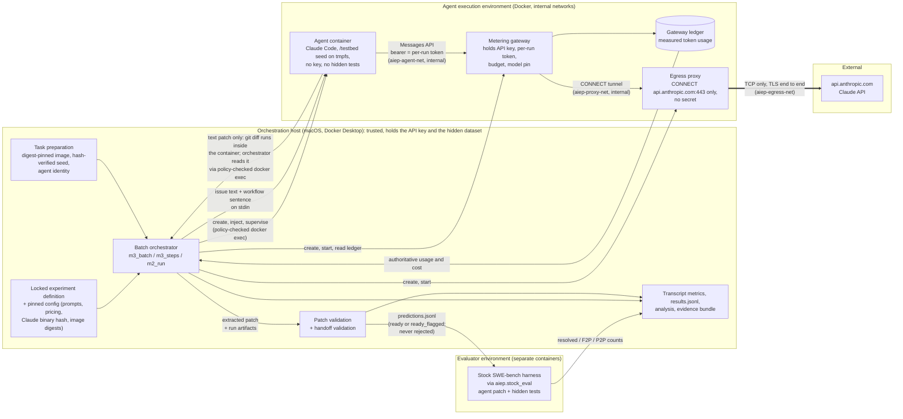

# AIEP architecture

How AIEP is built, how one experiment runs end to end, what each boundary does and does not protect, and what is not validated. Statements are tied to source files. Where a claim rests on a measured run rather than on code, the run is named. The isolation described here is **defence in depth for a local research harness, not an impenetrable host sandbox** (section 4).

## 1. System overview

AIEP is a local harness for comparing how a prescribed workflow changes the behaviour, resolution and cost of a coding agent (Claude Code) on SWE-bench Lite tasks. It exists because such a comparison is only meaningful if the two configurations differ in the workflow prompt and nothing else, the agent cannot see the answers, every request is metered by something the agent does not control, and grading happens in a different environment from the one that produced the patch.

Primary workflow: a **locked, self-hashed experiment definition** fixes tasks, prompts, model, client binary and budgets. A **batch orchestrator** prepares each task from a digest-pinned image, runs gold and no-op controls, then runs Config A and Config B for the task in an isolated agent container behind a metering gateway. The agent's text patch is validated, graded by the **stock SWE-bench harness**, and recorded as one result row. A descriptive paired analysis reads the rows.

What AIEP is not: it is not a benchmark, not a production service, and not a statistical study (Stage 1 is four tasks, one run per arm). It has no UI, database or cloud component.

## 2. High-level architecture

Bold arrow: the only outbound path from the agent execution environment (agent, gateway and proxy) to the external Claude API. It is not the only outbound path from the host: the evaluator's containers have separate general internet access (section 4), and the orchestration host itself is not network-restricted. Not drawn: the hidden test patch and the gold patch live in the local dataset snapshot on the host; the stock harness reads them there, and the handoff validator reads them only to scan for leaks.

## 3. Execution lifecycle

1. **Define and lock.** The E1 definition (`config/experiments/e1-exploratory-1.json`) is built by `scripts/m3_experiment.py build-e1`; `experiment_def.py` hashes it (`definition_sha256`) and validates it against the tracked configs. Locking, budgets and each execution approval are separate human decisions; a draft can never spend (`run_m3_pilot.py` refuses unless the definition is locked and `--approve-spend` equals its cap).
2. **Prepare each task** (once, approval-gated, `task_setup.py`, `image_digests.py`): re-verify the recorded registry manifests, pull the image **by digest**, require the local image ID to equal the digest, pin it, read `/testbed` once from a never-started container into a seed archive (`seed.py`, `seed_source.py`: only regular files, safe paths, size limits, no host git), pin the archive sha256 and check its lineage against the dataset's base commit, and verify the agent account. Pins live in tracked `config/*.json`.
3. **Start the batch.** `m3_batch.run_pilot` re-hashes the definition, re-derives the schedule from the registered seed, and halts on any difference. State is bound to the definition hash. A disk gate (16 GiB start, 12 GiB hard stop) and a pair-atomic budget reservation apply before each pair.
4. **Controls.** Before a task's agent runs, the **gold** control must resolve and the **no-op** control must not, both through the stock evaluator. A failure replaces the task by a pre-registered rule, never because of an agent outcome. No replacement occurred in Stage 1.
5. **Run an arm** (`m2_run.prepare` then `execute`, `lifecycle.run_with_gateway`). Everything that needs no Docker is checked first. Then, under a host-side lease (`lease.py`): verify the three networks; start the **proxy**, then the **gateway** (each created inert, code injected and verified entry by entry, then started); verify the live attachments (`networks.verify_topology`); create the **agent**, re-inspect it against the policy and check its running attachment (`agent_attachment.py`); inject the seed and the pinned Claude binary over `exec` stdin and verify them against manifests; run Claude with the prompt on **stdin**; supervise the wall clock and the gateway's stop reason; quiesce the container; extract the patch with git **inside the container**, diffed against the seed's own HEAD; tear down in reverse order (agent, gateway, proxy).
6. **Persist.** `artifacts.py` writes one run directory exclusively (secrets replaced by `[REDACTED]`, manifest written last). Failed and invalid runs are kept.
7. **Hand off and grade.** `handoff.py` checks artifact hashes, identity, accounting exactness and a host-side hidden-data scan, and returns `ready`, `ready_flagged` or `rejected`. A run with status `ready` or `ready_flagged` goes on to grading (`m3_batch.py`): its `predictions.jsonl` goes to `grading.grade`, which runs `python -m aiep.stock_eval`. Flags travel with the result row. A `rejected` run is never graded.
8. **Record.** `transcript.py` computes behavioural metrics, `results.build_row` writes one row to `results.jsonl`, and the state file is updated. After a **600 s gap** the second arm runs; after both, the batch removes the image it pulled.
9. **Analyse and package.** `analysis.py` / `scripts/m3_analyze.py` print the paired descriptive analysis; `scripts/build_e1_stage1_evidence.py` produces the sanitized bundle that `scripts/verify_e1_stage1_evidence.py` checks.

Halts (accounting incomplete, cost cap, hidden-data leak, handoff integrity failure, disk gates, and others) stop the batch; most can only be continued after a human acknowledges the halt id.

## 4. Network and trust boundaries

| Zone | Holds | Can reach | Notable controls |
|---|---|---|---|
| **Agent container** (nonroot, uid 1000) | issue text, per-run token, Claude binary, seed in `/testbed` tmpfs | the gateway, over `aiep-agent-net` only | read-only root, `cap_drop ALL`, `no-new-privileges`, 2 GiB, 512 pids, private IPC, no volumes or Docker socket (create kwargs are an allowlist, `container_policy.py`). No API key, no hidden tests. |
| **Gateway** | the real API key (in its container environment), the run token, the ledger | the agent (inbound) and the proxy only | on `aiep-agent-net` and `aiep-proxy-net`, both internal. Forwards only `POST /v1/messages` and `/v1/messages/count_tokens`, pins one model, refuses server-side tools, meters usage, enforces a soft budget, never follows redirects. Does the TLS handshake itself with certificate and hostname verification. |
| **Egress proxy** | no secret | `api.anthropic.com:443` | the only container on `aiep-egress-net`. Accepts only `CONNECT` to that exact host and port, resolves the name itself, requires every address to be public unicast, pins one, and copies bytes (never terminates TLS). |
| **Orchestration host** | key (from an environment variable), hidden dataset, Docker access, all run artifacts | everything | trusted. Only a text patch and the ledger come back from the containers. |
| **Evaluator** (separate containers) | agent patch, hidden test patch | **the general internet** (default Docker bridge) | created by the stock harness from the pinned image. Wrapper `stock_eval.py` removes `SYS_ADMIN`, drops all capabilities, sets `no-new-privileges`, 2 GiB, 1024 pids, 2 CPUs, and blocks image pulls and builds. |

Measured evidence for these boundaries: `scripts/m2_egress_validation.py` against real Docker Desktop and a local mock upstream (final pass: 81 PASS, 1 LIMITATION, 0 FAIL; `docs/M2_EGRESS_ARCHITECTURE.md`), and each E1 run's recorded isolation check (the agent attached only to `aiep-agent-net`, no published ports, on a network flagged internal). The architecture document's measurement that the gateway and agent get `ENETUNREACH` to host, private, link-local and public addresses dates from that validation, not from the E1 runs.

**Residual risk, stated plainly.**
- **The proxy container can reach Docker Desktop host services.** It has a default route through the egress network, and the Docker Desktop host gateway and the Mac's LAN address were reachable from it at validation time. It is not network-isolated from them. Protection is its code (fixed destination, no client-chosen address, every resolved address must be public) plus the facts that it holds no secret, runs non-root with no capabilities, and is reachable only from the gateway. A bug in the proxy, or code execution inside it, would expose host services.
- **This is defence in depth, not an impenetrable host sandbox.** It relies on Docker Desktop's VM and on the correctness of AIEP's own small components, and it has not been independently audited.
- **The evaluator is not network-restricted.** It executes agent-written patches with general internet access because its build step fetches build dependencies from PyPI. It holds no key and no Docker socket (`docs/M1_RESULTS.md` section 8.3).
- **The real key sits in the gateway container's environment** and on the host. Keeping it off command lines and out of the repository is an operator responsibility.

## 5. Component responsibilities

| Component | Source | Responsibility |
|---|---|---|
| Experiment definition and prompts | `experiment_def.py`, `experiment_build.py`, `experiment.py`, `config/experiments/`, `config/workflow_prompts_v2.json`, `scripts/m3_experiment.py` | Self-hashed, validated definition; schedule derived from a seed; prompt rendering; Claude flags (identical for both arms). |
| Orchestrator | `m3_batch.py`, `m3_steps.py`, `scripts/run_m3_pilot.py` | Per-task blocks, halts, budget reservation, resumable state, plan mode by default. |
| One run | `m2_run.py`, `lifecycle.py`, `agent_runner.py`, `container_exec.py`, `scripts/run_m2_agent.py` | Compose and supervise proxy, gateway and agent; injection and verification; patch extraction; teardown. |
| Task preparation | `task_setup.py`, `image_digests.py`, `task_pins.py`, `seed.py`, `seed_source.py`, `preparation_gate.py`, `manifest.py`, `config/image_digests.json`, `config/seeds.json`, `config/task_identities/` | Digest-pinned images, hash-verified seeds, identity pins, deterministic replacement on preparation failure; `manifest.py` verifies the pinned local dataset snapshot. |
| Container and network policy | `container_policy.py`, `networks.py`, `listen.py`, `agent_env.py`, `agent_attachment.py`, `limits.py` | Allowlist create kwargs per role, re-inspection, exact network membership, listen-address rules. |
| Metering gateway | `gateway.py`, `gateway_runner.py`, `ledger.py`, `pricing.py` | Authenticate, forward two endpoints, meter, budget, stop on violation, write the ledger; price from `config/model_pricing.json`. |
| Egress proxy | `egress_proxy.py`, `proxy_lifecycle.py` | Restricted CONNECT tunnel with address validation and bounds. |
| Run safety | `lease.py`, `reaper.py`, `scripts/reap_aiep_containers.py` | Host-side lease; reaping of abandoned AIEP containers only. |
| Patch and artifacts | `patch.py`, `artifacts.py` | Validated text patch; redacted, hashed run directory. |
| Handoff validation | `handoff.py`, `rejection_policy.py`, `scripts/validate_handoff.py` | Decide whether a run may be graded; classify rejections; hidden-data scan. |
| Evaluation | `stock_eval.py`, `grading.py`, `scripts/m1_eval.sh`, `scripts/m3_grade.py` | Stock harness with reduced privileges and an image-acquisition guard; controls; generalized grading. |
| Hardened evaluator (**not operational**) | `evaluator.py`, `gate.py`, `evaluator_readiness.py` | Fail-closed successor. Blocked: `config/wheelhouse.json` is `unpopulated`. No grading has used it. |
| Metrics, results, analysis | `transcript.py`, `results.py`, `analysis.py`, `scripts/m3_analyze.py` | Test-attempt and edit classification (parser v2), result rows, paired descriptive analysis. |
| Evidence | `scripts/build_e1_stage1_evidence.py`, `scripts/verify_e1_stage1_evidence.py`, `evidence/e1-stage1/` | Sanitized Stage 1 bundle and its offline verifier. |

## 6. Experiment integrity and reproducibility

- **Locked definition.** `definition_sha256` covers tasks, prompt hashes, model, Claude binary sha256, dataset revision, budgets, schedule and metric definitions. The batch re-derives the schedule from the seed and halts on a mismatch. E1's hash is `9601b345da705b7e8bbdba251b902f4c7637482fd2e87e732dcba0dc36875eff`.
- **One-sentence manipulation.** Config A and B share a template and differ only in the workflow sentence; the handoff validator checks the recorded prompt, template and workflow hashes against the registered prompt set, and the experiment environment has no parameter that can carry the arm.
- **Pinned environment.** Task images are pulled by digest and pinned by image ID; seeds by sha256 and lineage; the agent and evaluator use the same image (checked in the handoff); the Claude binary is hash-pinned; the dataset revision is recorded in `config/dataset.json`.
- **Metering outside the agent.** Cost is computed from the gateway's measured token usage and a recorded price table. Claude Code's own `total_cost_usd` is a client estimate and is stored separately. The ledger is complete only if every forwarded request has a finishing line; incomplete accounting halts the batch.
- **Evidence.** Each run's artifact manifest hashes every file. The committed bundle lets anyone recompute counts, tokens, costs, cache effects and pair gaps offline and checks the recorded summaries agree with each other (`python3 scripts/verify_e1_stage1_evidence.py`). The hashes of withheld files do not let a third party verify those files.
- **What is not guaranteed.** Model output is not deterministic, so a rerun would not reproduce patches; Stage 1 has one repetition per cell. Cost depends on prompt-cache state. The evaluator's pip dependencies are unpinned and unrecorded.

## 7. Known limitations

**Implemented and exercised in real runs:** the full path above, with the real API in two calibration runs and in the eight E1 Stage 1 runs, and with real-Docker validation of the network topology against a mock upstream.

**Incomplete or not validated:**
- The **hardened evaluator** is implemented and unit-tested but cannot grade; the stock evaluator is the only one that has.
- **Evaluator egress** is unrestricted and its pip build dependencies are unpinned (`docs/M1_RESULTS.md` sections 8.3 to 8.5).
- **Platform:** only macOS on Apple Silicon with Docker Desktop (amd64 images under emulation, one run at a time, at least 16 GiB free disk) has been used. Linux and other Docker engines are untried.
- **Budgets are soft.** Usage is known only after a response; only a spend limit on the API key is a hard cap.
- **Handoff and metrics defects:** handoff flag text states the passing condition, so a flag means it failed; the hidden-data scan ignores lines under 40 characters; the parser counts a test-file edit as a test-fix cycle and treats Bash edits heuristically.
- **Coverage:** "resolved" means the task's F2P tests pass and the P2P tests from the touched test files are maintained; it does not show the rest of the repository suite still passes.
- **Stage 2** (sphinx-10325, requests-863) is unprepared and unrun.
- **Stale text:** some module docstrings (for example `lifecycle.py`, `agent_runner.py`) and `docs/M2_PHASE1_NOTES.md` and `docs/M2_PHASE2_DESIGN.md` still describe earlier, fakes-only states or superseded network designs. The code and `docs/M2_EGRESS_ARCHITECTURE.md` are authoritative for the current topology.

## 8. E1 Stage 1: what was and was not established

Stage 1 ran 4 tasks, one run per arm per task: 8 scored runs, four gold controls and four no-op controls (eight controls total), 34 API requests, $0.2337872 gateway-computed (not provider billing). All 8 runs were valid and resolved their task; Config B started a test runner in 4 of 4 runs and Config A in 0 of 4.

**Demonstrated:** the harness works end to end with exact accounting and the isolation checks recorded, and, as an observation, Config B started a test runner in 4/4 runs versus 0/4 for Config A (an exploratory sample of one run per cell, not a causal or statistical claim). **Not established:** whether iteration improves resolution (there was no outcome difference), any confirmed implementation-fix revision after a test failure (the one parser-counted cycle edited a test expectation), or any statistical or causal claim.

Full account: [`docs/research/E1_STAGE1_REPORT.md`](research/E1_STAGE1_REPORT.md). Verifiable data: [`evidence/e1-stage1/`](../evidence/e1-stage1/README.md). Quickstart and commands: [`README.md`](../README.md). Egress design in detail: [`M2_EGRESS_ARCHITECTURE.md`](M2_EGRESS_ARCHITECTURE.md).
